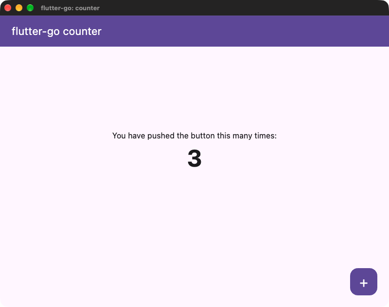
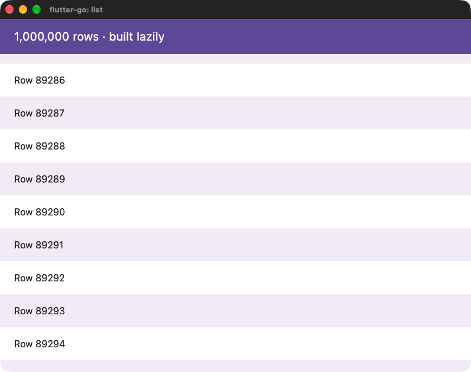

# flutter-go

An experiment: Flutter's architecture (widgets → elements → render objects)
written in Go, rendered by Flutter's own renderer, **Impeller**, through its
[standalone C API](https://github.com/flutter/flutter/tree/master/engine/src/flutter/impeller/toolkit/interop).

```
Go framework  →  cgo  →  Impeller C API (libimpeller.dylib)  →  Metal
```

No Dart VM and no Flutter engine are involved.

## Status

Stages 0–7 of [PLAN.md](PLAN.md) are done: a render tree, a widget/element
layer with `setState`, taps, a headless widget tester, layout that matches
real Flutter on 11 reference scenes, and frame-time measurements, and a lazily built scrolling list.
Findings and the recommendation are in [PLAN.md](PLAN.md#findings-2026-11-25).

 

## Run (macOS)

```sh
./scripts/fetch_impeller_sdk.sh   # downloads the SDK pinned in IMPELLER_SHA
go run ./cmd/counter              # the classic counter app
go run ./cmd/list                 # 1,000,000-row lazy list (wheel to scroll)
go run ./cmd/hello                # step 0: raw Impeller from Go
go test ./...                     # unit, widget and (if generated) diff tests
FLUTTER=/path/to/flutter ./scripts/difftest.sh   # compare layout with real Flutter
PERF=1 go test ./perf -v -run Budget   # frame-time percentiles (run alone)
```

Requires Go 1.24+ and Xcode command-line tools.

## Layout

| Path | What |
|---|---|
| `rendering/` | Render tree: constraints, layout, paint, hit testing (pure Go) |
| `widgets/` | Widgets, elements, State, BuildOwner, pointer routing |
| `widgettest/` | Headless tester in the style of flutter_test |
| `app/` | Runs a widget tree in a window with Impeller |
| `difftest/` | Same scenes in Go and Dart; compares geometry |
| `perf/` | Frame budget test and benchmarks |
| `examples/counter/` | The counter app and its widget tests |
| `impeller/` | Minimal Go binding to `impeller.h` |
| `platform/metal/` | CAMetalLayer setup and presentation (the only Objective-C) |
| `cmd/` | `counter`, `list` and `hello` executables |
| `IMPELLER_SHA` | Flutter commit whose prebuilt Impeller SDK we use |
